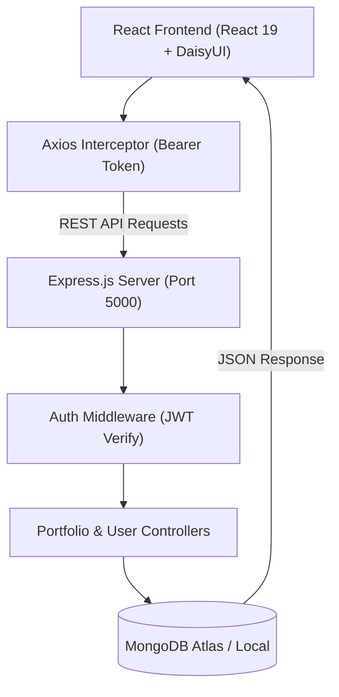

# PortfolioGen — Full-Stack Developer Portfolio Builder (MERN)

A modern, full-stack web application designed for developers and creators to effortlessly build, customize, edit, preview, and publish responsive developer portfolio websites with personalized shareable links and DaisyUI theme customization.

[](https://www.mongodb.com/)
[](https://react.dev/)
[](https://nodejs.org/)
[](https://expressjs.com/)
[](https://tailwindcss.com/)
[](https://daisyui.com/)
[](LICENSE)

---

## 🌟 Key Highlights & Features

### 🔐 1. Authentication & Security
- **JWT & Bcrypt:** Secure user registration, password encryption with `bcrypt`, and stateless JWT-based authentication.
- **Axios Request Interceptor:** Automatically injects `Authorization: Bearer <token>` into all outgoing API calls.
- **Protected Routes:** Unauthorized visitors are safely redirected away from dashboard, edit, and settings pages.

### 🛠️ 2. Comprehensive Portfolio Creation
- **Section-by-Section Form Wizard:**
  - **👤 Basic Info:** Name, title/tagline, bio, and smart **auto-cropping profile picture upload** (client-side HTML5 canvas crops images into clean 256x256 squares).
  - **📬 Contact:** Email, GitHub, and LinkedIn profile URLs.
  - **⚡ Skills:** Dynamic tag manager with Enter-to-add and one-click removal.
  - **🚀 Projects:** Title, description, and live/GitHub project URLs.
  - **💼 Experience:** Company, role, duration, and achievements timeline.
  - **🎓 Education:** Institute, degree, and graduation year timeline.
- **Browser Auto-Save:** Draft changes automatically synchronize with `localStorage` (`portfolioDraft`) to prevent data loss.

### ✏️ 3. Full-Featured Portfolio Editor (`/portfolio/edit/:id`)
- **Tabbed Interface:** Easily jump between Basic Info, Contact, Skills, Projects, Experience, Education, and Appearance/Settings.
- **Theme & Visibility Controls:** Switch themes on the fly and toggle between **Public** and **Private** status.
- **Live Theme Sample Card:** Instantly previews the selected palette's primary, secondary, accent, and card styles.
- **Embedded Real-Time Preview:** Full in-app preview tab powered by `<PortfolioView />`.
- **Database Synchronization:** Updates persist immediately to MongoDB via `PUT /api/portfolios/:id`.

### 🔒 4. Public vs. Private Viewing System (`/p/:slug`)
- **Public Portfolios (`isPublic: true`):** Accessible to anyone worldwide via a clean, collision-resistant slug link (e.g. `/p/alex-smith-a4b2`).
- **Private Portfolios (`isPublic: false`):**
  - **Creator (Owner) Access:** The portfolio creator can always view their private portfolio when logged in, with an informative top banner (`🔒 Private Mode | Visible only to you`).
  - **Guest Protection:** Unauthenticated or unauthorized visitors receive a `403 Forbidden` response and an informative private lock screen.

### 🎨 5. Multi-Theme Engine & Website Customizer
- **DaisyUI v5 Integration:** Over 17+ rich color themes (`light`, `dark`, `cupcake`, `corporate`, `emerald`, `synthwave`, `retro`, `cyberpunk`, `dracula`, `night`, `valentine`, `halloween`, `forest`, `aqua`, `luxury`, `nord`, `sunset`).
- **Global Website Appearance (`/settings`):** Users can switch the entire application interface between Light, Dark, or custom themes in real time via DOM `data-theme` synchronization.
- **Multilingual Support:** English and Hindi localization support in Settings.

---

## 🏗️ Architecture & Flowcharts

For a detailed PDF document with flowcharts and step-by-step lifecycle diagrams, check out [MERN_Portfolio_Builder_Flowchart_and_Docs.pdf](./MERN_Portfolio_Builder_Flowchart_and_Docs.pdf).



---

## 📁 Repository Structure

```text
Mernprac/
├── backend/
│   ├── controllers/
│   │   ├── authcontroller.js       # Register & login authentication logic
│   │   ├── portfolioController.js  # CRUD operations & public/private slug view
│   │   └── userController.js       # User profile & password management
│   ├── middleware/
│   │   └── authMiddleware.js       # JWT bearer token verification
│   ├── models/
│   │   ├── user.js                 # User mongoose schema
│   │   └── portfolio.js            # Portfolio document schema
│   ├── routes/
│   │   ├── authroutes.js           # /api/auth routes
│   │   ├── portfolioRoutes.js      # /api/portfolios routes
│   │   └── userRoutes.js           # /api/users routes
│   ├── server.js                   # Express server entry point
│   └── package.json
├── frontend/
│   └── mernPrac/
│       ├── src/
│       │   ├── components/
│       │   │   ├── portfolio/
│       │   │   │   ├── portfolio.css       # Animations, gradients, & glassmorphism
│       │   │   │   └── PortfolioView.jsx   # Live portfolio presentation view
│       │   │   ├── sections/               # Modular form inputs (Basic, Contact, Skills, List)
│       │   │   ├── Navbar.jsx              # Navigation bar with responsive drawer
│       │   │   ├── Sidebar.jsx             # Dashboard sidebar menu
│       │   │   └── Protectedroute.jsx      # Auth guard for private routes
│       │   ├── context/
│       │   │   ├── PortfolioContext.jsx    # Draft state & auto-save sync
│       │   │   └── SettingsContext.jsx     # Global theme & language state
│       │   ├── layouts/
│       │   │   ├── Mainlayout.jsx          # Public navbar + footer layout
│       │   │   ├── Authlayout.jsx          # Centered authentication layout
│       │   │   └── Dashboardlayout.jsx     # Drawer navigation layout
│       │   ├── pages/
│       │   │   ├── Home.jsx                # Landing page
│       │   │   ├── Login.jsx & Signup.jsx  # Authentication forms
│       │   │   ├── Dashboard.jsx           # Analytics, views & overview
│       │   │   ├── MyPortfolio.jsx         # Portfolio cards list & actions
│       │   │   ├── CreatePortfolio.jsx     # Carousel wizard
│       │   │   ├── EditPortfolio.jsx       # 7-tab portfolio editor
│       │   │   ├── PortfolioPreview.jsx    # Fullscreen draft preview
│       │   │   ├── PublicPortfolio.jsx     # Published website (/p/:slug)
│       │   │   ├── Profile.jsx             # User profile editor
│       │   │   └── TempSettings.jsx        # Website theme & password settings
│       │   ├── App.jsx                     # Route definitions
│       │   ├── main.jsx                    # Root render & Axios interceptor
│       │   └── index.css                   # Tailwind v4 & DaisyUI v5 themes
│       ├── vite.config.js                  # Vite bundler & API proxy configuration
│       └── package.json
├── MERN_Portfolio_Builder_Flowchart_and_Docs.pdf  # Comprehensive architecture & flowcharts PDF
└── README.md
```

---

## 🔌 API Endpoints Reference

### **Authentication** (`/api/auth`)
| Method | Endpoint | Description | Access |
|---|---|---|---|
| `POST` | `/signup` | Register a new user account | Public |
| `POST` | `/login` | Authenticate credentials & return JWT | Public |

### **User Profile** (`/api/users`)
| Method | Endpoint | Description | Access |
|---|---|---|---|
| `GET` | `/me` | Retrieve logged-in user profile | Private (Token required) |
| `PUT` | `/profile` | Update user profile name and avatar | Private (Token required) |
| `PUT` | `/change-password` | Verify old password & set new password | Private (Token required) |

### **Portfolios** (`/api/portfolios`)
| Method | Endpoint | Description | Access |
|---|---|---|---|
| `GET` | `/` | Fetch all portfolios of logged-in user | Private (Token required) |
| `POST` | `/` | Create and publish a new portfolio | Private (Token required) |
| `GET` | `/:id` | Fetch full portfolio details by ID | Private (Owner only) |
| `PUT` | `/:id` | Update an existing portfolio | Private (Owner only) |
| `DELETE` | `/:id` | Permanently delete a portfolio | Private (Owner only) |
| `GET` | `/public/:slug` | View portfolio (Allows all if public; allows owner if private) | Conditional (Public / Owner) |

---

## ⚙️ Getting Started (Local Setup)

### **Prerequisites**
- [Node.js](https://nodejs.org/) (v18.x or v20.x+)
- [MongoDB](https://www.mongodb.com/) (Local server or MongoDB Atlas cluster)
- [Git](https://git-scm.com/)

---

### **1. Clone the Repository**
```bash
git clone https://github.com/ridhi431/mernprac.git
cd mernprac
```

---

### **2. Backend Configuration**
1. Navigate to the `backend` folder:
   ```bash
   cd backend
   ```
2. Install dependencies:
   ```bash
   npm install
   ```
3. Create a `.env` file in the `backend/` directory:
   ```env
   PORT=5000
   MONGODB_URI=your_mongodb_connection_string
   JWT_SECRET=your_super_secret_jwt_key
   ```
4. Start the backend development server:
   ```bash
   npm start
   # or with nodemon:
   npx nodemon server.js
   ```
   *The backend will run on `http://localhost:5000`.*

---

### **3. Frontend Configuration**
1. Open a new terminal and navigate to the frontend directory:
   ```bash
   cd frontend/mernPrac
   ```
2. Install frontend dependencies:
   ```bash
   npm install
   ```
3. Start the Vite development server:
   ```bash
   npm run dev
   ```
4. Open [http://localhost:5173](http://localhost:5173) in your browser.

---

## 📄 Documentation & Flowcharts

A complete PDF manual containing vector architecture flowcharts, navigation trees, security sequences, and API reference tables is available directly in this repository:
- 📥 **[Download MERN_Portfolio_Builder_Flowchart_and_Docs.pdf](./MERN_Portfolio_Builder_Flowchart_and_Docs.pdf)**

---

## 🤝 Contributing

Contributions, bug reports, and feature requests are welcome!
1. Fork the Project
2. Create your Feature Branch (`git checkout -b feature/AmazingFeature`)
3. Commit your Changes (`git commit -m 'Add some AmazingFeature'`)
4. Push to the Branch (`git push origin feature/AmazingFeature`)
5. Open a Pull Request

---

## 📜 License

Distributed under the **ISC License**. See `LICENSE` for more information.
